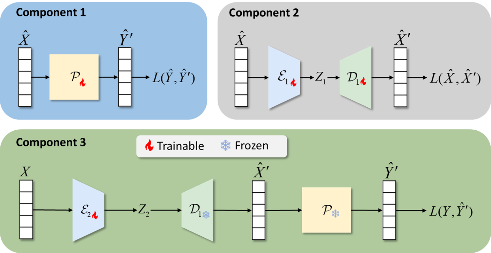
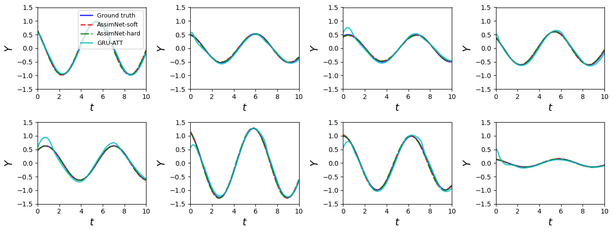
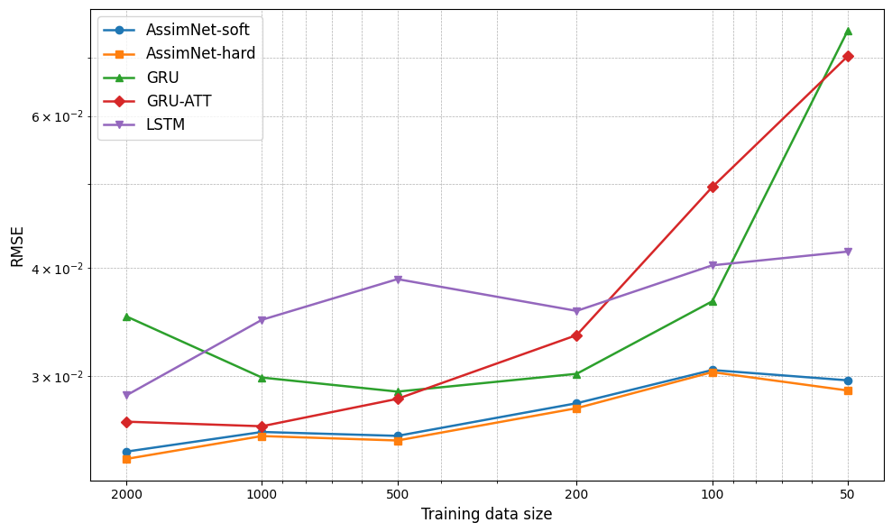
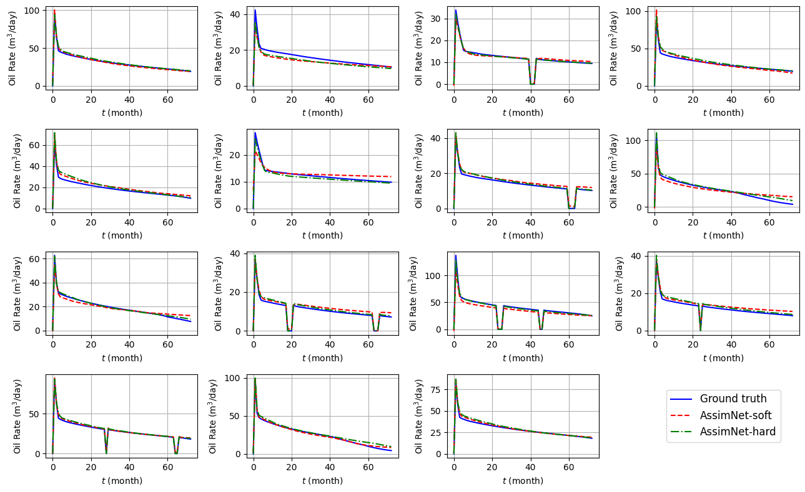
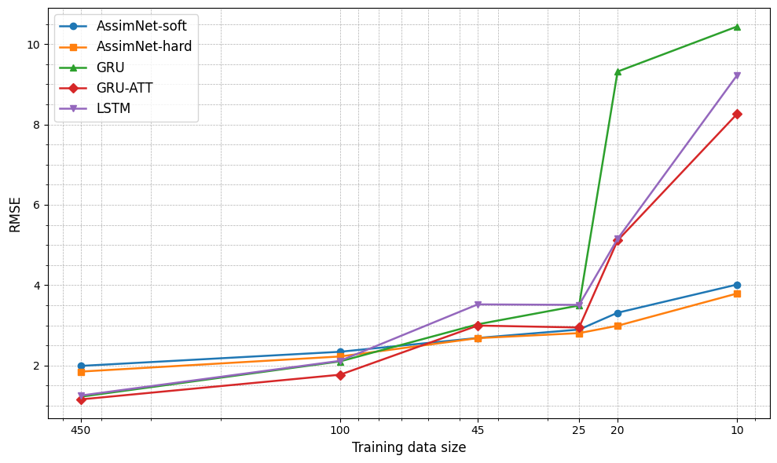
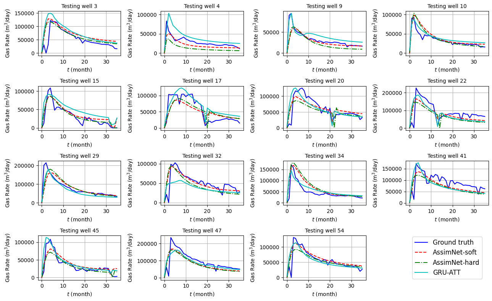
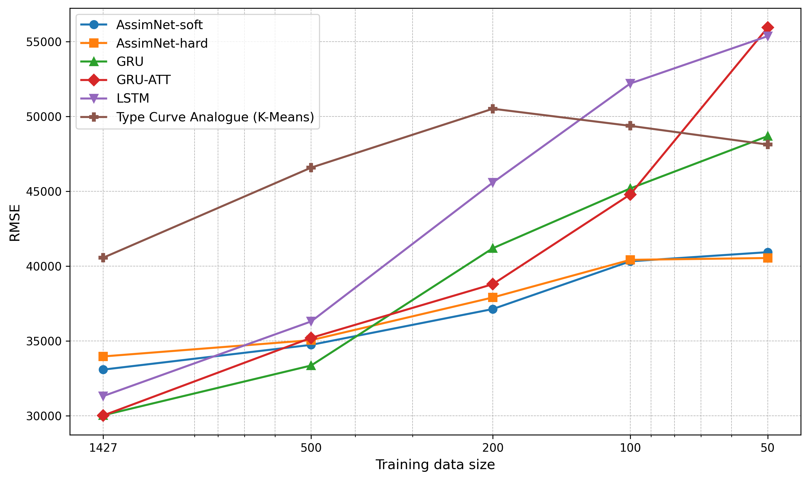

# AssimNet

**AssimNet (Assimilation Neural Network)** forecasts subsurface production time series from field measurements while using numerical simulation to constrain the forecast. In reservoir applications, measurements such as well logs do not directly provide all the porosity, permeability, saturation, or fracture properties required by a simulator. AssimNet learns an *equivalent* set of simulation inputs from those measurements and calibrates the resulting production forecast against observed production.

This README summarizes the method and three case studies from the AssimNet manuscript. The figures below are extracted from that manuscript.

## Method

Let **X** be field measurements, **Y** the observed production time series, **X̂** simulator inputs, and **Ŷ** simulator outputs. AssimNet connects these two domains through three components:

1. **Learn the simulator response (Component 1).** Run many *sample-wise simulations* of a physically meaningful unit, such as one well, over a selected range of simulator inputs. Train a proxy network **P** to reproduce the mapping **X̂ → Ŷ**. This gives the later training stage a fast, differentiable approximation of the simulator. The simulator input ranges should be checked to ensure their output profiles cover the observed production behavior.
2. **Learn the simulator-input space (Component 2).** Train a variational autoencoder on **X̂**. Its encoder maps simulation inputs into a latent space **Z₁**; its decoder **D₁** reconstructs valid simulation inputs from that space. Reconstruction loss is the main objective, with mild KL regularization to keep the latent space smooth.
3. **Assimilate field data (Component 3).** A second encoder **E₂** maps **X → Z₂**. The pretrained decoder and proxy are then frozen, giving **X → E₂ → D₁ → P → predicted Y**. Only **E₂** is trained against observed production. An optional KL term discourages **Z₂** from drifting too far from the latent region learned in Component 2. The inferred inputs are *equivalent inputs that reproduce the production response*; they are not necessarily unique estimates of the true reservoir properties.

Known variables, such as bottom-hole pressure, formation thickness, or completion design, can bypass the encoder and enter the proxy as **conditional inputs**. After training, **AssimNet-soft** predicts through the proxy; **AssimNet-hard** sends the inferred simulation inputs to the original simulator. The latter directly enforces that simulator's response, while the former avoids an additional simulation run.

## Case I — Sinusoidal functions

**Setup.** This controlled test treats inputs `(d, e)` to one sinusoidal function as field measurements and its time series as the observed response. A different cosine function, parameterized by `(a, b, c)`, acts as the imperfect simulator. AssimNet must infer `(a, b, c)` from `(d, e)` so that the simulator reproduces the observed curve. The proxy is trained on 5,000 cosine-function samples; the comparison includes GRU, attention-enhanced GRU (GRU-ATT), and LSTM models trained directly from measurements to time series.

**Prediction curves (manuscript Fig. 5).** Across the displayed test examples, the soft and hard AssimNet curves nearly overlap the ground truth. The hard output remains smooth because it comes directly from the cosine function. GRU-ATT shows larger departures on several examples, particularly near the start of a curve. The figure demonstrates that AssimNet learned an effective mapping between the two functions' parameter spaces.

**Limited-data comparison (Fig. 6).** As the number of training samples falls from 2,000 to 50, both AssimNet variants retain relatively stable test RMSE, whereas the direct GRU and GRU-ATT errors rise sharply. With **50 samples**, AssimNet-hard achieves **31.19% lower RMSE** than LSTM, the best baseline at that size. Only the field-data encoder is fitted in this final stage; the proxy and VAE retain their pretrained weights.

## Case II — Cardium synthetic wells

**Setup.** This case generates synthetic well logs and six-year oil-production histories from a heterogeneous, five-layer Cardium reservoir model. AssimNet receives the logs and learns equivalent permeability, porosity, and water saturation for a simpler, homogeneous single-well simulator. Bottom-hole pressure and formation thickness are supplied directly as conditional inputs. The dataset contains **500 wells** (450 for training and 50 held out); 3,000 runs of the simplified simulator train the proxy.

**Production profiles (Fig. 9).** Both forecast modes follow the ground-truth decline curves over 72 months. In examples with prescribed shut-ins, they also reproduce the sharp production drops because the shut-in signals are known conditional inputs. Small mismatches remain in peak rates and some late-time segments; the simplified one-layer model is not an exact copy of the heterogeneous generator.

**Limited-data comparison (Fig. 10).** At larger training sizes, the direct GRU, GRU-ATT, and LSTM baselines are competitive. Their errors rise as field-like training examples become scarce, while AssimNet changes more gradually. With **10 samples**, AssimNet-hard has **53.94% lower RMSE** than GRU-ATT, the strongest baseline at that size.

## Case III — Montney shale gas wells

**Setup.** The field case forecasts the first **36 months** of gas production for **1,486 hydraulically fractured wells**. Wells starting production before January 2020 form the training set (1,427 wells); 59 later wells are held out for testing. The sample-wise simulator represents the stimulated reservoir volume around one horizontal well, including multiple fracture stages and dual-porosity, dual-permeability flow. Its 1,725 runs train the proxy. Known completion and schedule variables enter as conditional inputs. Training uses smoothed production profiles, while evaluation uses the original observations.

**Unseen-well profiles (Fig. 12).** The 15 displayed test wells show that both AssimNet modes usually capture the main peak and decline trend. Some observed curves contain abrupt operational fluctuations that the simulator training data cannot reproduce because detailed operating conditions, especially bottom-hole pressure, are unavailable. GRU-ATT can follow some local variations, but also produces unusual shapes on some wells; the simulation-guided forecasts remain closer to expected decline behavior.

**Limited-data comparison (Fig. 13).** With the full training set, direct data-driven models have lower RMSE. As the training set shrinks, their errors increase more quickly. With **50 wells**, AssimNet-soft has **16.77% lower RMSE** than GRU, the strongest deep-learning baseline, and **15.84% lower RMSE** than the K-means type-curve analogue. In this field case the soft mode generally outperforms the hard mode; proxy approximation error and simulator grid rounding can change the response when inferred continuous inputs are passed back to the simulator.

## Code

- [`AssimNet_tensorflow/`](AssimNet_tensorflow/): TensorFlow notebooks for Cases I–III. 
- [`AssimNet_pytorch/`](AssimNet_pytorch/): PyTorch implementation and a runnable, synthetic Case I example; see its [setup and usage guide](AssimNet_pytorch/README.md).
